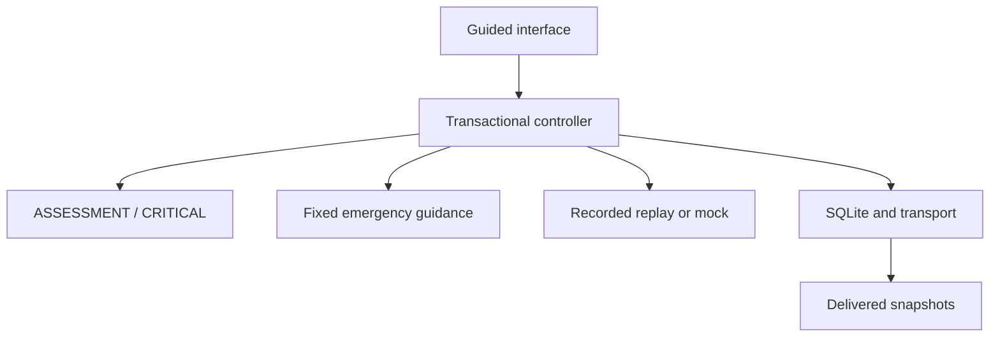

# PATCH architecture

PATCH is a local Python application with Streamlit views, SQLite persistence and Pydantic contracts. The controller owns all writes. The HSM has exactly two states, ASSESSMENT and CRITICAL; safety pending, workflow stages, handoff ready and closure are separate fields.

## Safety clearance

The controller requires persisted affirmative answers to both responsiveness and normal breathing, an enabled interview and no pending recheck before invoking the backend or accepting normal workflow actions. Neither UI defaults nor an unfinished form supply evidence. NO blocks the interview; UNKNOWN requires clarification. Critical handling takes priority over normal workflow order.

Checks use `question_set=responsiveness_normal_breathing_v2`. The UI previews response-specific instructions immediately when NO is selected. Confirmation persists both answers. Emergency rechecks are stored separately and cannot automatically downgrade CRITICAL. Structured deterioration invalidates older safety guidance; new checks are needed to determine current instructions.

`emergency_guidance.py` maps explicit findings to fixed instructions and source links. It does not diagnose from free text, invoke a model or execute an emergency procedure. See SAFETY_GUIDANCE.md for sources and scope.

## Workflow and context

`episodes.workflow` persists stage, question index and the observation index at the beginning of a reassessment. Display priority is CLOSED, CRITICAL, SAFETY, then HISTORY/VITALS/EXAM/REPORT/SENT. The backend enforces the order, including disallowing premature normal handoffs.

C01/C02 replay case_data JSONs. Only the current question is sent to the replay backend. Its answer becomes episode evidence when explicitly recorded. Future answers, private scenarios and unperformed results are excluded from persisted current context and Earth snapshots. Historical model-generated reports are not promoted to evidence.

The original N02/N04/N06 scenarios use five generic history questions, documented vital results or their unavailability, configured examinations and handoff. Rechecks use two focused questions while preserving history. This is demonstration sequencing, not a validated clinical completeness rule.

Before accepting an interview output, the controller verifies episode identity, state revision, interview permission and closure. The current backend is synchronous and makes no network calls. A future live integration must execute outside the write transaction and revalidate state on application.

## Persistence

Every command uses a SQLite transaction. The command ID and parameter fingerprint support idempotent retries; reusing an ID with different inputs is rejected. Events, observations, telemetry, packets, settings and command results are persisted. A new case creates an independent episode and retains prior episodes.

Events and observations are append-only. Observation corrections reference the earlier record. Packet payloads are separate from transport metadata and protected from updates by a database trigger. Historical evidence is not translated or rewritten by the English UI update. SQLite WAL is used for local operation; this is not a multiuser authenticated service.

## Simulation clock and transport

The single UI clock button advances by the specified number of minutes. Commands process every intermediate minute, scenario event and arrival chronologically. N04's event at T+2 records the new values before generating its critical snapshot. N06 cuts the link at T+20 minutes, requests reassessment at T+6 hours and restores the link at T+7 hours.

Packets are QUEUED while the sender link is DOWN. When UP, they enter IN_TRANSIT and arrive after the one-way delay. Already transmitted packets continue travelling through a sender outage. Only DELIVERED payloads are queried by the Earth view. There is no ACK or return order channel.

N02/N04/N06 generate synthetic pulse/SpO2 each minute and retain a 60-minute activation snapshot with 122 samples, including both endpoints. C01/C02 supply no historical telemetry, so their snapshot is empty; reported measurements retain unknown observation times. Both kinds of case retain the actual entry time.

## Guidance snapshots

An alert or handoff stores the contemporaneous safety guidance, including branch, source answers, question-set version, supporting event/time when available, scope and source links. The initial alert remains pending even when the crew completes the check later. Guidance selection uses only applicable recorded checks; a later deterioration prevents reuse of a stale reassuring check.

## Boundaries

This release has no live model, physical sensors, general emergency language detector, authentication, bidirectional Earth orders or clinical certification. It includes adult demonstration instructions grounded in terrestrial first-aid sources; spacecraft-specific treatment techniques remain the responsibility of mission-approved procedures. Tests were neither added nor run as a suite, in accordance with the user's request.
