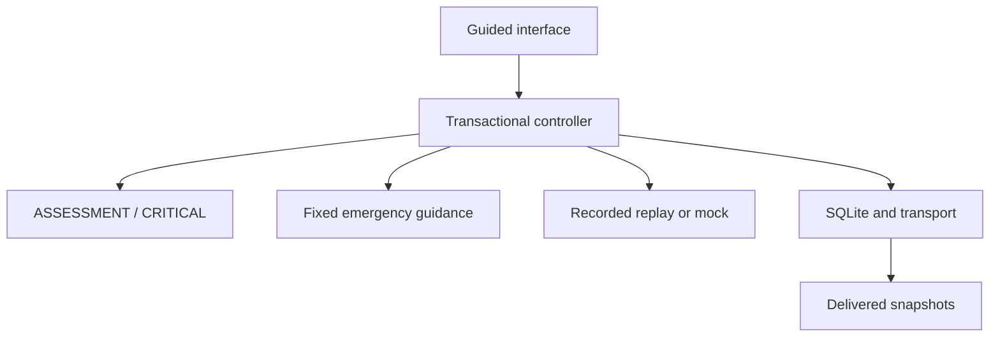

# PATCH architecture

PATCH is a local Python application with Streamlit views, SQLite persistence and Pydantic contracts. The controller owns all writes. The HSM has exactly two states, ASSESSMENT and CRITICAL; safety pending, workflow stages, handoff ready and closure are separate fields.

## Safety clearance

The controller requires persisted affirmative answers to both responsiveness and normal breathing, an enabled interview and no pending recheck before invoking the backend or accepting normal workflow actions. Neither UI defaults nor an unfinished form supply evidence. NO blocks the interview; UNKNOWN requires clarification. Critical handling takes priority over normal workflow order.

Checks use `question_set=responsiveness_normal_breathing_v2`. The UI previews response-specific instructions immediately when NO is selected. Confirmation persists both answers. Emergency rechecks are stored separately and cannot automatically downgrade CRITICAL. Structured deterioration invalidates older safety guidance; new checks are needed to determine current instructions.

`emergency_guidance.py` maps explicit findings to fixed instructions and source links. It does not diagnose from free text, invoke a model or execute an emergency procedure. See SAFETY_GUIDANCE.md for sources and scope.

## Workflow and context

`episodes.workflow` persists stage, question index and the observation index at the beginning of a reassessment. Display priority is CLOSED, CRITICAL, SAFETY, then HISTORY/VITALS/EXAM/REPORT/SENT. The backend enforces the order, including disallowing premature normal handoffs.

C01–C04 replay case_data JSONs. Only the current question is sent to the replay backend. Its answer becomes episode evidence when explicitly recorded. Future answers, private scenarios and unperformed results are excluded from persisted current context and Earth snapshots. Historical model-generated reports are not promoted to evidence.

The active catalog contains only the four recorded conversations. Their source phases determine the demonstration sequence; that sequence is not a validated clinical completeness rule. C04 stops for a safety recheck before a partial handoff.

Before accepting an interview output, the controller verifies episode identity, state revision, interview permission and closure. The current backend is synchronous and makes no network calls. A future live integration must execute outside the write transaction and revalidate state on application.

## Persistence

Every command uses a SQLite transaction. The command ID and parameter fingerprint support idempotent retries; reusing an ID with different inputs is rejected. Events, observations, telemetry, packets, settings and command results are persisted. A new case creates an independent episode and retains prior episodes.

Events and observations are append-only. Observation corrections reference the earlier record. Packet payloads are separate from transport metadata and protected from updates by a database trigger. Historical evidence is not translated or rewritten by the English UI update. SQLite WAL is used for local operation; this is not a multiuser authenticated service.

## Simulation clock and transport

The single UI clock button shows the amount it will advance. Its default target is the earliest pending message arrival or unhandled future scenario event, with a one-minute fallback. Technical details offers an optional fixed interval. Computing this target never mutates the clock or advances the clinical workflow. Commands process every intermediate minute, scenario event and arrival chronologically. The current four fixtures have no timed clinical events or synthetic sensor stream. The clock delivers packets; Case 4 requests a recheck when its final recorded answer is saved.

Packets are QUEUED while the sender link is DOWN. When UP, they enter IN_TRANSIT and arrive after the one-way delay. Already transmitted packets continue travelling through a sender outage. Only DELIVERED payloads are queried by the Earth view. There is no ACK or return order channel.

C01–C04 supply no historical telemetry, so their activation snapshots are empty. Reported measurements retain unknown observation times and the actual simulation entry time. The removed fixtures no longer generate synthetic pulse/SpO2 or timed clinical changes.

## Guidance snapshots

An alert or handoff stores the contemporaneous safety guidance, including branch, source answers, question-set version, supporting event/time when available, scope and source links. The initial alert remains pending even when the crew completes the check later. Guidance selection uses only applicable recorded checks; a later deterioration prevents reuse of a stale reassuring check.

## Boundaries

This release has no live model, physical sensors, general emergency language detector, authentication, bidirectional Earth orders or clinical certification. It includes adult demonstration instructions grounded in terrestrial first-aid sources; spacecraft-specific treatment techniques remain the responsibility of mission-approved procedures. Tests were neither added nor run as a suite, in accordance with the user's request.

## Presentation layer

`app.py` keeps clinical commands in the existing controller. It presents recorded questions and clearly marked unsaved demo answers, a five-stage progress strip, a readable SBAR and delivery status derived from persisted packet transport data. Earth previews use the delivered packet payload rather than rebuilding a report from the current episode. Starting another demonstration creates an episode; it does not reset or delete past records. Technical details is off by default and hides record inspection, trace exports and saved-case selection.

## Four-case catalog and terminal recheck

`RECORDED_CASE_IDS` is the only catalog allowlist: C01–C04. UI labels derive from that catalog, and saved episodes are filtered through it before selecting an active episode. Removed fixtures cannot be started and retired histories cannot be resumed through the UI. Stored histories are not purged or rewritten.

C04's final curated step includes `after_action=request_safety_recheck`. `recorded_step` first stores the actual patient reply and advances the recorded cursor, then emits a structured `recheck_requested`, disables interview through the existing HSM and sends a snapshot. Its terminal source text is retained as provenance, not interpreted as executable model instructions. The underlying next workflow phase is REPORT, but the pending safety check takes display/action priority. After affirmative answers, no new model question is generated: the only available continuation is a handoff of the incomplete recorded assessment. Negative answers keep the critical pathway. Replayed or stale step commands cannot trigger the transition twice.
