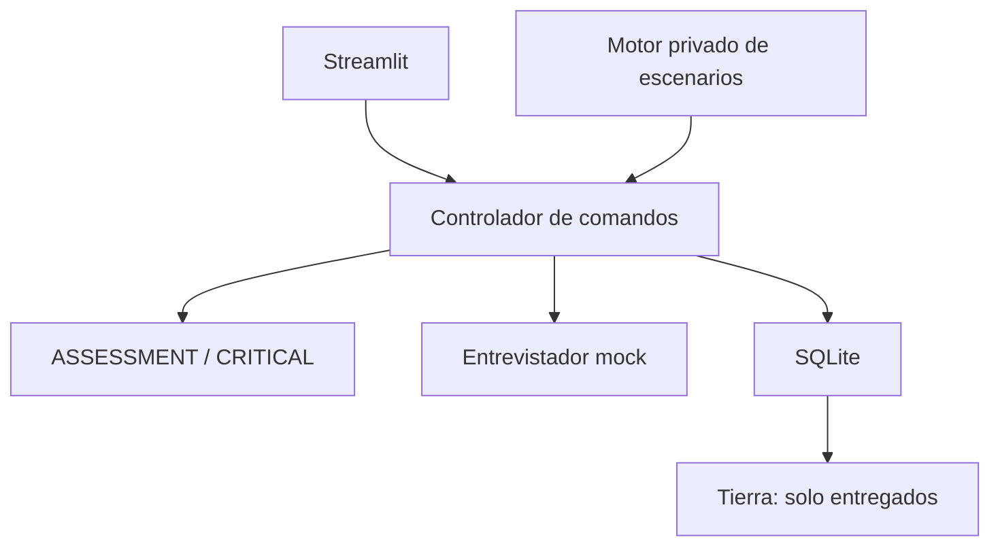

# Arquitectura implementada · PATCH MVP

La especificación `PATCH_MVP_ENGINEERING_SPEC_N02_N04_N06` de 14-11-2026 gobierna esta entrega. Reemplaza el diseño previo de seis estados, escenarios A/B, ACK bidireccionales y Qwen por el alcance actual: N02/N04/N06, dos estados y comunicación solo a Tierra. Los contratos de hallazgos y turnos quedan como extensión; el MVP no exige extracción clínica de JSON en cada respuesta.

## Escrituras y persistencia

`Controller.command(action, command_id=..., **kwargs)` es la entrada de mutaciones. Todas las escrituras de un comando comparten `BEGIN IMMEDIATE`; una excepción revierte el comando completo. `commands` guarda una huella de parámetros y su resultado: repetir un ID idéntico retorna el resultado sin repetir efectos; reutilizarlo con otra acción se rechaza.

La UI mantiene solo selección, formularios e IDs de comando en Session State. El estado clínico, reloj, historial y paquetes se recuperan de SQLite. Cada ejecución de la UI abre/cierra su propia conexión. WAL y el timeout de SQLite serializan escrituras locales.

Tablas: `episodes`, `events`, `observations`, `telemetry_samples`, `packets`, `commands`, `settings`. Los eventos y observaciones se agregan, no se sobrescriben. Las correcciones contienen `replaces_observation_id`; el informe muestra los registros no reemplazados y la exportación conserva todos. El payload de cada paquete se almacena separado de sus metadatos de transporte y un trigger impide actualizarlo.

## Tiempo y cronología

El reloj de cada episodio es entero en segundos desde T0. Se aceptan tiempos negativos solo para datos previos; las observaciones pueden tener hora desconocida (`null`). Cada avance procesa todos los minutos, los eventos estructurados intermedios y las llegadas, manteniendo horas exactas. No hay dependencias del reloj de pared.

En un empate, los eventos del escenario se procesan por `(at, id)`, luego la muestra periódica si no se registró ya y el transporte. El evento N04 registra sus sensores antes de emitir la alerta crítica. Los eventos del escenario llevan un identificador que impide repetición. El salto máximo es 48 h por comando para evitar bloqueos accidentales de la interfaz.

La caja negra inicial contiene 61 instantes por métrica (T−60..T0 con extremos incluidos), 122 registros. El snapshot queda incorporado íntegramente al primer paquete; no depende de una ruta local inaccesible a Tierra. Después se mantienen muestras cada minuto y una ventana reciente de una hora para visualización.

## HSM y autorización

Solo existen `ASSESSMENT` y `CRITICAL`. `check_pending`, `interview_enabled`, `report_ready` y `closed` son indicadores separados. El recheck incrementa la versión, bloquea entrevista y requiere repetir conciencia/respiración. UNKNOWN nunca se interpreta como normal.

Las transiciones críticas provienen de eventos estructurados o de un chequeo manual con NO. No hay detector semántico ni reglas clínicas generales por umbral. La revisión humana bloquea la entrevista sin convertir automáticamente el estado a CRITICAL. No existe descenso automático de CRITICAL.

El controlador captura versión de estado antes del mock, y compara episodio, versión, permiso de entrevista y cierre antes de aplicar el resultado. Los turnos antiguos quedan como historia, señalados como no activos. La implementación síncrona no afirma interrupción física de inferencia ni concurrencia durante una llamada remota.

## Fronteras de conocimiento

`config_scenarios.py` contiene la configuración privada. `get_current_context` construye una lista explícita de perfil, reloj, chequeos, telemetría registrada, resultados obtenidos, catálogo y conversación. No devuelve la verdad oculta, cronogramas futuros ni exámenes sin realizar. `llm_anamnesis.py` no importa configuraciones de escenarios.

El operador puede consultar el guion privado dentro de Simulador. Esto es una separación funcional de la demo, no autorización multiusuario: las tres vistas comparten la misma aplicación local. Tierra solo consulta `packets(..., delivered_only=True)`; no consulta el contexto actual para reconstruir informes.

## Transporte

- Con enlace UP, un paquete se envía de inmediato y llega en `sent_at + delay`.
- Con enlace DOWN, permanece QUEUED sin `sent_at` ni `arrives_at`.
- Al recuperar UP, los pendientes se envían en orden de creación; todos pueden llegar a la misma hora porque no se simula ancho de banda.
- Un paquete IN_TRANSIT completa el viaje aunque el enlace de envío caiga.
- Solo DELIVERED es visible en Tierra. No hay ACK ni órdenes de retorno.

## Límites y extensión LLM

El entrevistador actual hace preguntas genéricas predefinidas. No es MedGemma, no razona sobre texto libre, no genera diagnósticos y no extrae entidades clínicas. Los informes usan una plantilla SBAR determinista. No se infieren negativos ni hipótesis que no estén documentados; el relato se conserva literalmente.

La interfaz del backend devuelve `ClinicalAssessmentTurn`. Antes de añadir un backend de red hay que sacar su ejecución de la transacción SQLite, definir timeouts y fallback, conservar el chequeo de versión al aplicar, y validar referencias de evidencia si se activan hallazgos estructurados. No se incluye una integración remota sin credenciales bajo apariencia de funcionamiento real.

El repositorio suministrado tenía contratos incompletos y una persistencia de la arquitectura anterior. Esta entrega sustituye esa API por la del MVP, añade `controller.py` y utiliza una base nueva. No incluye migración de bases previas, autenticación, acceso público, sensores reales ni validación clínica.
