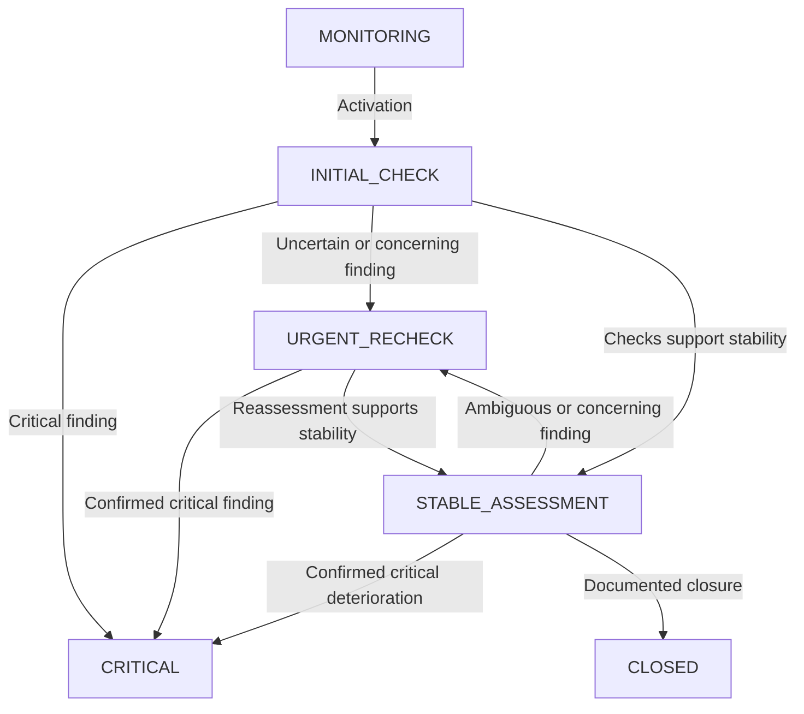

# PATCH Architecture

PATCH will simulate health episodes during a mission to Mars using fictional crew members, events, and telemetry. The spacecraft crew can start a structured assessment and retain the information it gathers while messages travel to Earth. The project is a software demonstration built around synthetic scenarios.

## Components and responsibilities

PATCH is designed as a modular Python monolith with a Streamlit interface, a SQLite database, and shared Pydantic contracts. The hierarchical state machine (HSM) determines the episode state and permitted actions. The communication link applies the simulated delay independently, so onboard assessment can continue while messages are in transit.

| File | Planned responsibility |
| --- | --- |
| [`app.py`](../app.py) | Receives interface commands, coordinates the modules, and builds the Spacecraft, Earth, and Simulator views from persisted data. Commands go through the event engine. Rendering reads and displays data. |
| [`contracts.py`](../contracts.py) | Defines Pydantic models, allowed values, and serialization shared by the scenarios, HSM, persistence layer, and inference adapter. |
| [`config_scenarios.py`](../config_scenarios.py) | Defines fictional profiles, prior telemetry, timed events, checks, and reference data for scenarios A and B. The clinical lead reviews the illustrative rules. |
| [`core_hsm.py`](../core_hsm.py) | Processes events, applies transition rules, tracks changes to the episode state, and determines which actions each state allows. |
| [`space_link_db.py`](../space_link_db.py) | Manages SQLite transactions, the mission clock, the persistent record, and delayed message delivery in both directions. |
| [`llm_anamnesis.py`](../llm_anamnesis.py) | Wraps optional inference, validates assessment turns and their evidence, checks whether proposed actions still apply, and supplies predefined questions when inference fails or is disabled. |

## Episode flow

1. Manual activation or a telemetry alert opens an episode. PATCH retains up to one hour of available prior data with its original timestamps and sources. The same operation records the activation and queues an `INITIAL_ALERT` with the information available at that moment, before the interview begins.
2. The HSM records the reason for activation and the initial check of consciousness and breathing. Unknown or ambiguous essential information triggers a guided reassessment. A lost signal is recorded as uncertainty.
3. The stable path allows an adaptive text interview and scenario-approved measurements or exam checks. The critical path activates predefined scenario steps and suspends the interview. A confirmed critical event takes priority during any active assessment.
4. PATCH records findings and state changes, which can trigger updates to Earth. The Earth-facing summary includes findings with their sources, recorded measurements and examination results, pertinent negatives, unresolved hypotheses, and outstanding gaps. It retains the SBAR structure (Situation, Background, Assessment, and Recommendation).
5. Once the controller authorizes a handoff, the `report_ready` flag indicates that a report is available while monitoring and state transitions continue. The episode ends with a documented closure.

Leaving `CRITICAL` requires new documented evidence and an explicit transition rule. The HSM checks every proposed action against the action catalog and the permissions for the current state.

## Shared contracts

| Contract | Data and behavior |
| --- | --- |
| `MissionClock` | Identifies the mission and scenario and stores MET in seconds, the one-way delay, and a counter that tracks clock changes. |
| `TelemetrySample` | Records the metric, available value, unit, source, quality, and observation time in MET. A missing signal is flagged and its value is left empty. |
| `ClinicalEvent` | Immutable event with a unique ID, episode, type, source, MET, and associated data. |
| `ProtocolState` | Records the episode state, its revision counter, the time it changed, and the event that prompted the change. |
| `ClinicalFinding` | Open-vocabulary description with a controlled category and source, evidence, an originating patient turn or record reference, and a revision counter. Status values are `present`, `denied`, `unknown`, and `not_assessed`. |
| `ClinicalAssessmentTurn` | Captures the current problem summary, new findings, working hypotheses, open uncertainties, a proposed next action with a brief rationale, and the model's declaration of assessment sufficiency. |
| `MedicalMessage` | Records the ID, direction, type, source state revision, payload captured at creation, and MET timestamps for sending, scheduled delivery, and actual delivery. |
| `EpisodeSummary` | Carries open-vocabulary findings, vital measurements, physical examination findings, pertinent negatives, unresolved hypotheses, uncertainties, missing information, pending assessments, the episode timeline, and structured SBAR. |

See [`contracts.py`](../contracts.py) for the field definitions.

## Mission clock, persistence, and communication link

- **Mission clock.** MET (*Mission Elapsed Time*) is the shared virtual clock. It advances through explicit commands. When time advances, the simulator processes every event in the interval in `(met_seconds, event_id)` order and delivers eligible messages. A separate monotonic clock measures inference latency.
- **Persistence.** SQLite stores the clock, episodes, telemetry, events, finding revisions, message queue, and inference log. Streamlit Session State holds interface data. Unique command, event, and message IDs, together with transactions, let the simulator retry an action without duplicating its effects.
- **Delivery.** Each message holds a snapshot of the information available when it was sent. Scheduled delivery is the send MET plus the configured delay. A message moves from `queued` to `delivered` once it reaches that time and the link is available. An outage leaves messages in the queue for retry.
- **Return messages.** Earth creates a new message for each `ACK` or conditional request. Both use the same one-way delay. An `ACK` confirms receipt. When a non-therapeutic request arrives, the HSM checks the episode, the state revision the request was based on, its conditions, and its expiration. A request that no longer applies is marked as stale or pending reassessment.

With an available link and a **12-minute delay in each direction**, scenario B follows this schedule.

| Message | Direction | Sent (MET) | Delivered (MET) |
| --- | --- | --- | --- |
| `INITIAL_ALERT` | Spacecraft → Earth | T+00 | T+12 |
| `CRITICAL_UPDATE` | Spacecraft → Earth | T+03 | T+15 |
| `ACK` or `CONDITIONAL_REQUEST` | Earth → Spacecraft | T+12 | T+24 |

## Adaptive clinical assessment

The HSM enables the assessment in `STABLE_ASSESSMENT`. MedGemma receives relevant patient responses and recorded observations through an Ollama adapter. It can read telemetry and suggest measurements. Sensor control stays with the simulator. The `ClinicalAssessmentTurn` updates the problem summary, findings, working hypotheses, and uncertainties as information becomes available.

| Proposed action | Data carried by the turn |
| --- | --- |
| `ask` | A base question for the next patient turn. |
| `examine` | A plan with one or more measurements or examination items from the approved catalog. |
| `handoff_ready` | A declaration that the assessment has enough information to propose a handoff. |

Each action includes a brief rationale. Pydantic validates the fields and action-specific requirements. Before accepting a finding, the adapter must check its references against the current episode's trusted sources and verify any patient quote against the referenced text. These checks establish provenance. Clinical interpretation requires separate review. Working hypotheses stay distinct from patient reports and measured observations.

Before each inference call, PATCH captures the episode ID and state revision. Before applying findings or acting on the proposal, the controller checks that both still match and that the HSM authorizes the action. A handoff proposal also requires external safety and consistency checks. The HSM retains control over safety transitions and can interrupt an active assessment after a critical event. PATCH discards and logs stale output, including responses from blocking inference calls.

Qwen is optional and receives only the approved base question for an `ask` action and style constraints. If the simulator cannot verify that the paraphrase preserves the meaning, the interface shows the base question. If MedGemma fails or the simulator runs without models, the interview uses predefined scenario questions. Both scenarios must be runnable end to end in that mode.

## Simulator views

| View | Data and actions |
| --- | --- |
| **Spacecraft** | Available telemetry and its quality, prior readings, current HSM state and its reason, text interview, findings, and outgoing messages with scheduled delivery times. A processed deterioration event updates the state and replaces the active question. |
| **Earth** | Alerts and reports drawn from messages already delivered to Earth, with their original timestamps. Operators can acknowledge receipt and send a conditional request. |
| **Simulator** | Scenario selection and reset, clock controls, synthetic event injection, and inspection of the message queue and audit log. An injection creates an event that the HSM processes. The views then refresh from persisted state. |

## Design verification

| Case | Expected outcome |
| --- | --- |
| A · Interview during the delay | The spacecraft crew begins the assessment while the alert is in transit. At T+12, Earth receives a snapshot of the information available at T+00. |
| B · Deterioration at T+03 | The HSM moves to `CRITICAL`, invalidates the previous question, and Earth receives the update at T+15. The request sent at T+12 is reassessed on arrival at T+24. |
| Retried command or interface restart | A retried command has a single effect. Restarting the interface restores the persisted state, clock, and message queue. |
| Failed inference or invalid output | The core continues processing the clock and events. During a stable interview, the interface uses the base question or a predefined question, depending on the model that failed. |
| New finding or proposed action | A new description is accepted with a valid category and source. An unsupported quote or an exam item outside the catalog is rejected. The HSM authorizes the next action. |

Detailed scripts will go in [`SCENARIOS.md`](SCENARIOS.md) and runtime measurements in [`RESULTS.md`](RESULTS.md).
